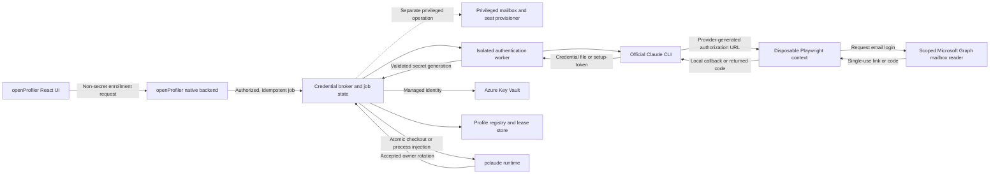

# Claude OAuth Enrollment and Automated Reauthentication

Status: proposed
Target: openProfiler after `0.1.4`
Scope: authorized Claude Code profile enrollment, reauthentication, and
automation-token issuance through the official Claude CLI

Related feature: [Cloud Credential Vault and Broker](cloud-credential-vault-feature.md)

## Summary

openProfiler should automate authorized Claude credential enrollment by
orchestrating Anthropic's supported Claude CLI, a restricted Microsoft 365
mailbox reader, and an isolated Playwright browser. openProfiler must not
implement Anthropic's OAuth client, invent OAuth endpoints, or copy login state
from a general-purpose browser profile.

The initial browser and email authorization produces either:

1. a complete native Claude profile credential written by `claude auth login`;
   or
2. a one-year, inference-only automation token printed by
   `claude setup-token`.

After a native profile has been enrolled, openProfiler can use the provider's
supported refresh-token provisioning variables to create a credential in an
isolated runtime without repeating email authorization. Every operation remains
subject to account authorization, exact identity binding, refresh-owner
leasing, and accepted-generation publication.

## Authorization Gate

This feature must not ship until the owning organization has confirmed that its
Anthropic agreement permits the proposed internal automation.

Anthropic documents subscription OAuth as an authentication method for ordinary
use of native Anthropic applications, including Claude Code. Anthropic also
states that third-party developers must not offer Claude.ai login or route Free,
Pro, or Max credentials on behalf of users. openProfiler must obtain written
confirmation for its specific Team or Enterprise deployment, or use Claude
Console API keys, Microsoft Foundry, or another supported enterprise provider
instead.

The approval applies only to authorized accounts and does not permit:

- creating or accessing accounts without the account owner's authorization;
- bypassing CAPTCHA, MFA, SSO, phone verification, consent, or organization
  policy;
- sharing one subscriber's credential with unrelated users;
- presenting openProfiler as Anthropic's OAuth client;
- routing non-Claude-Code traffic against subscription credentials; or
- extracting tokens from a browser session or undocumented provider endpoint.

## Goals

- Enroll an authorized Claude profile without exposing credentials to the React
  webview, logs, telemetry, or operators.
- Reauthenticate a profile without risking its last accepted credential.
- Support native Claude profile credentials and supported automation tokens as
  distinct credential formats.
- Read a single-use Claude login message from an explicitly scoped Exchange
  Online mailbox.
- Complete browser authorization in an isolated, disposable Playwright context.
- Bind every accepted credential to the expected profile, account, and Claude
  organization.
- Store accepted credentials as exact, versioned Azure Key Vault secrets.
- Coordinate exactly one refresh owner per provider account.
- Fail closed on ambiguous identity, unexpected organization selection,
  provider-policy blocks, or browser challenges.

## Non-Goals

- openProfiler does not become an OAuth authorization server or OAuth client for
  Anthropic.
- Mailbox possession alone does not prove the resulting Claude account or
  organization identity.
- Exchange mailbox provisioning does not create a Claude account, assign a
  subscription, or grant a Claude Code seat.
- The login worker does not receive Exchange Administrator, Global
  Administrator, or direct Key Vault data-plane permissions.
- The system does not retain magic links, verification codes, browser cookies,
  authorization URLs, or email bodies after a transaction.
- Automation does not retry CAPTCHA, MFA, SSO, phone, consent, or organization
  policy failures.
- Key Vault presence does not prove that a credential remains valid.

## Supported Credential Formats

| Format                       | Provider operation                               | Storage and runtime use                                                                                             | Limitations                                                                                                          |
| ---------------------------- | ------------------------------------------------ | ------------------------------------------------------------------------------------------------------------------- | -------------------------------------------------------------------------------------------------------------------- |
| `claude_native_oauth_bundle` | `claude auth login --claudeai --email <address>` | Store the complete `.credentials.json`; atomically materialize it into the selected profile                         | The owning Claude runtime may rotate the refresh token, so it requires a refresh-owner lease and publication watcher |
| `claude_code_oauth_token`    | `claude setup-token`                             | Store the single token as a versioned secret; inject it only as `CLAUDE_CODE_OAUTH_TOKEN` into the launched process | One-year, inference-only credential; no Remote Control or claude.ai connector access; `--bare` does not use it       |

The two formats must not be merged. A native credential bundle is not created by
combining an automation token with fields from another generation.

## Supported Provider Interface

The Claude provider adapter uses only documented Claude CLI behavior:

```text
claude auth login --claudeai --email <address>
claude setup-token
claude auth status --json
```

For an already enrolled account, the adapter may provision through:

```text
CLAUDE_CODE_OAUTH_REFRESH_TOKEN
CLAUDE_CODE_OAUTH_SCOPES
```

When those variables are present, `claude auth login` exchanges the existing
refresh credential instead of opening a browser. Because the exchange may
rotate the refresh generation, it requires the current refresh-owner lease and
must publish the resulting complete bundle before releasing the lease.

Provider CLI versions and observed interface capabilities are recorded as
non-secret transaction metadata. Unsupported or changed prompts fail with
`provider_adapter_incompatible` instead of falling back to undocumented HTTP
calls.

## Architecture



## Trust and Privilege Separation

### Native openProfiler backend

The Tauri/Rust backend accepts non-secret requests from the webview, authorizes
the selected company and profile, creates an idempotent reauthentication job,
and displays sanitized state. It never returns credentials, OAuth URLs, magic
links, codes, cookies, message bodies, or credential fingerprints to the
webview.

### Credential broker

The broker:

- authorizes the caller for an immutable profile ID;
- acquires and fences the provider-account refresh lease;
- issues a short-lived worker job capability;
- accepts a complete validated credential generation;
- writes a new exact Key Vault secret version;
- conditionally advances the accepted-generation pointer; and
- emits sanitized audit events.

The worker does not receive a reusable Key Vault role. It receives only a
transaction-scoped broker capability.

### Mailbox provisioner

Mailbox or Entra user creation is a distinct, privileged workflow. It may use a
just-in-time administrative identity to create or license the approved mailbox,
but that identity is never available to the browser or login worker.

Creating a mailbox is insufficient. The workflow must also establish the
corresponding Claude account, organization membership, subscription or seat,
and Claude Code entitlement through an Anthropic-supported administrative
process such as approved invitation, SSO, or SCIM.

Shared mailboxes or non-person identities may be used only when the Anthropic
agreement explicitly allows them. Otherwise, enrollment stops before requesting
a Claude login message.

### Mailbox reader

The mailbox reader uses a separate Entra service principal or managed identity.
It receives only Microsoft Graph `Mail.Read`, scoped with Exchange Online RBAC
for Applications to the dedicated authentication mailboxes or administrative
unit. It must not also hold an unscoped Entra `Mail.Read` grant, because
independent grants are additive.

Graph change notifications may wake the transaction, but the worker retrieves
and validates the message through Graph before use. A bounded polling fallback
is allowed when webhook delivery is unavailable.

### Authentication worker

The worker runs under a dedicated OS identity or disposable container and owns:

- a mode-`0700` staging Claude configuration home;
- an isolated Playwright browser context with no persistent user profile;
- a private provider-CLI pseudoterminal;
- a memory-only channel between the CLI, mailbox adapter, browser adapter, and
  credential collector; and
- a transaction-scoped broker capability.

The worker and browser should share a network namespace so the provider's
localhost callback works. If the callback is unavailable, the adapter may use
the CLI's documented returned-code prompt. It must not expose the code through
the UI or clipboard.

## Domain Model

### ClaudeEnrollmentTransaction

```text
transaction_id
request_id
idempotency_key
profile_id
company_connection_id
expected_email
expected_account_id
expected_organization_id
credential_format
provider_cli_version
worker_id
lease_id
lease_epoch
started_at
expires_at
state
human_action_reason
result_code
```

No field contains a token, authorization URL, magic link, verification code,
cookie, email body, or raw OAuth response.

### ClaudeCredentialEnvelope

```text
schema_version
provider = "claude"
profile_id
credential_format
credential_bundle
expected_account_id
expected_organization_id
provider_cli_version
published_at
source_transaction_id
source_lease_id
source_lease_epoch
generation_id
```

`credential_bundle` is secret material and exists only in the native worker,
authenticated transport, broker memory, Key Vault, and an approved local
credential target. The envelope is stored as one indivisible Key Vault secret
version.

## Transaction State Machine

```text
requested
  -> prerequisites_check
  -> waiting_for_lease
  -> staging
  -> provider_login_started
  -> waiting_for_email
  -> browser_authorizing
  -> collecting_credential
  -> validating_identity
  -> publishing_generation
  -> materializing
  -> verifying
  -> completed
```

Terminal and intervention states are:

```text
human_action_required
provider_policy_blocked
identity_mismatch
credential_invalid
lease_lost
publication_conflict
expired
cancelled
failed
recovery_required
```

A worker may resume only from persisted non-secret job state. It never persists
an authorization URL, magic link, code, cookie, or unaccepted credential to make
a browser transaction resumable.

## Initial Enrollment Workflow

1. Resolve the immutable profile, company authority, expected email, and
   requested credential format.
2. Confirm the mailbox, Claude account, organization membership, seat, and
   Claude Code entitlement.
3. Acquire the provider-account enrollment and refresh lease.
4. Preserve the currently accepted credential generation, if any.
5. Create the restricted staging home and disposable browser context.
6. Remove conflicting authentication variables from the worker environment,
   including `ANTHROPIC_API_KEY`, `ANTHROPIC_AUTH_TOKEN`,
   `CLAUDE_CODE_OAUTH_TOKEN`, and cloud-provider selection variables.
7. Start the selected official Claude CLI operation in a private
   pseudoterminal.
8. Parse the provider-generated authorization URL as secret input and open it
   directly in Playwright.
9. Enter only the expected profile email and request the login message.
10. Wait for one matching message through the scoped mailbox reader.
11. Open the verified single-use link in the same Playwright context. If Claude
    returns a code, pass it directly to the waiting CLI process.
12. Stop at `human_action_required` for CAPTCHA, MFA, SSO, phone verification,
    changed consent, or ambiguous account or organization selection.
13. Collect the native credential file or setup-token without streaming CLI
    output to the UI or job logs.
14. Validate structure, scopes, expiry, credential format, live provider status,
    account identity, and organization identity.
15. Publish a new exact Key Vault version under the current lease and epoch.
16. Conditionally advance the accepted-generation pointer.
17. Atomically materialize the accepted native credential, or configure
    transaction-scoped process injection for an automation token.
18. Perform a minimal provider verification without forcing an unnecessary
    refresh.
19. Destroy the staging home and browser context, publish the sanitized result,
    and release the lease.

## Email Correlation and Link Safety

Magic links and verification codes are authentication factors. The mailbox
adapter must require all of the following:

- the exact expected recipient mailbox;
- a message received after the transaction's email request time;
- an expected Anthropic sender domain and authentication result;
- an expected subject pattern;
- one outstanding authentication transaction for the mailbox;
- an unexpired transaction window;
- an allow-listed HTTPS destination host after safe URL parsing; and
- a message not already consumed by another transaction.

The adapter must not select the newest vaguely matching email. It rejects
forwarded messages, replies, unexpected redirect hosts, multiple matches,
expired messages, and links associated with another transaction.

The raw message body, link, code, and browser response never enter normal logs,
audit records, traces, screenshots, support bundles, or analytics. Consumption
metadata may record only the message ID, transaction ID, timestamps, and
sanitized result. Message deletion or modification requires a separate mailbox
retention policy and is not implicit in credential enrollment.

## Credential Collection and Validation

### Native credential bundle

The collector waits for the staged `.credentials.json` to become stable across
two reads and validates:

- it is a regular file beneath the staging root and not a symlink;
- the top-level credential schema is recognized;
- access and refresh tokens are non-empty;
- required scopes and expiry metadata are present;
- the subscription and authentication methods match the requested flow;
- the provider reports a logged-in first-party Claude authentication method;
- the expected account and organization identity can be proven; and
- the file remains unchanged throughout collection.

An access token that currently succeeds does not prove that the refresh token
is usable. The broker must retain refresh ownership and treat the first managed
refresh as a credential-generation transition.

### Automation token

`claude setup-token` writes its result to the terminal rather than a credential
file. The native pseudoterminal adapter therefore classifies the matching output
span as secret before any logging, rendering, or telemetry hook receives it.

The token is stored as `claude_code_oauth_token`, never inside
`.credentials.json`, the profile manifest, `.profile.json`, `settings.json`, a
shell profile, or an environment file. The broker injects it into only the
authorized Claude process as `CLAUDE_CODE_OAUTH_TOKEN`.

The profile records the one-year expiry and schedules reauthentication before
the warning window. Automation-token expiry does not trigger conversion to a
native credential or use of another profile's refresh token.

### Identity binding

Email possession is necessary but not sufficient. Before publication,
openProfiler must prove that the credential belongs to the expected Claude
account and organization.

The provider adapter should prefer a documented machine-readable Claude
identity response. If the installed CLI returns `null` for email or organization
identity, openProfiler must not infer identity solely from:

- the email entered in the browser;
- the mailbox that received the magic link;
- a subscription type;
- a browser page label without stable organization identity; or
- successful access to a model or usage endpoint.

Until Anthropic exposes an adequate supported identity binding, enrollment
requires a human confirmation that displays only non-secret account and
organization information obtained from the authorization UI. A previously
recorded account ID or organization ID mismatch always fails closed.

## Refresh-Token Provisioning

Once a complete accepted native credential exists, a new authorized runtime may
be provisioned without email login:

1. Acquire the refresh-owner lease with a higher fencing epoch.
2. Check out the exact accepted credential generation into worker memory.
3. Set `CLAUDE_CODE_OAUTH_REFRESH_TOKEN` and
   `CLAUDE_CODE_OAUTH_SCOPES` only for the isolated `claude auth login`
   process.
4. Collect the complete resulting staged credential.
5. Validate identity and credential shape.
6. Publish any rotated generation before activating the runtime.
7. Clear the worker environment and destroy the staging home.

The old and new refresh generations must never be used concurrently. Losing the
lease during exchange moves the transaction to `recovery_required`; the worker
cannot publish or retry with the previous refresh token.

## Materialization and Runtime Ownership

A native credential is written beside the canonical destination, flushed,
assigned mode `0600`, and atomically renamed. The destination must be a regular
file beneath the configured profile root, and no path component may cross an
attacker-controlled symlink.

The activated Claude runtime owns refresh rights only while its lease is active.
openProfiler watches the parent credential directory because Claude may replace
the credential file atomically. A changed file is accepted only after stable
reads, complete validation, identity equality, and lease fencing. Each accepted
rotation becomes a new Key Vault version and advances the accepted-generation
pointer conditionally.

An automation token is injected into one authorized process. It is not copied to
other profile homes, and it does not participate in native refresh-token file
watching.

## Human and Administrative Gates

The transaction stops without automatic retries when it encounters:

- CAPTCHA or bot-detection challenge;
- MFA, SSO, phone verification, or conditional-access interaction;
- changed provider consent;
- more than one selectable account or organization;
- unexpected account, organization, subscription, or seat;
- OAuth disabled by the Claude organization;
- Claude Code disabled or no eligible seat;
- mailbox quarantine or message-delivery policy failure;
- a link or code that cannot be bound to the transaction;
- provider CLI interface incompatibility; or
- an existing refresh owner that cannot be safely stopped or transferred.

The UI reports the clearing actor and action, such as `Claude organization
administrator must enable OAuth`, `Exchange administrator must release the
message from quarantine`, or `authorized user must complete MFA`. It never
offers to bypass the control.

## Failure and Recovery

- A failed or cancelled login leaves the previous accepted generation intact.
- An incomplete or invalid staged credential is destroyed and never published.
- A Key Vault version written before a failed pointer update is an unaccepted
  orphan and is never restored automatically.
- A provider-policy `403` becomes `provider_policy_blocked`, not a retry loop.
- A revoked or expired credential becomes `reauthentication_required`.
- Multiple matching email messages become `human_action_required`.
- A lost lease or uncertain refresh generation becomes `recovery_required`.
- An unmanaged runtime that may refresh prevents ownership transfer.
- Cleanup failure seals the staging directory and raises a security alert; it
  does not expose the directory path or contents in the webview.

## Broker API Additions

The existing proposed broker surface includes profile reauthentication. The
Claude adapter requires job-oriented status and human continuation:

```text
POST /v1/profiles/{profile-id}/reauthentication
GET  /v1/profiles/{profile-id}/reauthentication/{transaction-id}
POST /v1/profiles/{profile-id}/reauthentication/{transaction-id}/continue
POST /v1/profiles/{profile-id}/reauthentication/{transaction-id}/cancel
```

Every mutation requires an idempotency key, caller authorization, current lease
where applicable, and transaction expiry. `continue` accepts only a signed
human-action acknowledgment or non-secret organization selection identifier. It
never accepts a token, link, code, cookie, email body, or credential file from
the webview.

## Audit Events

Sanitized event types include:

```text
claude_enrollment_requested
claude_prerequisites_satisfied
claude_provider_login_started
claude_email_received
claude_human_action_required
claude_credential_validated
claude_identity_mismatch
claude_provider_policy_blocked
claude_generation_published
claude_profile_materialized
claude_enrollment_completed
claude_enrollment_failed
```

Events contain transaction ID, profile ID, company authority, worker ID, lease
epoch, timestamps, result, and sanitized error code. They never contain token
values or fingerprints, OAuth URLs, magic links, verification codes, cookies,
email bodies, raw provider output, or raw JWT claims.

## Acceptance Criteria

1. A profile can complete authorized native Claude enrollment without secret
   material entering the React webview, logs, telemetry, screenshots, or crash
   reports.
2. An automation token can be generated, stored as an exact Key Vault version,
   and injected without being written to a profile or settings file.
3. A failed or cancelled enrollment leaves the prior accepted credential
   unchanged.
4. The login worker cannot read mail outside the dedicated authentication
   mailbox scope.
5. The login worker has no mailbox-provisioning or Exchange administrative
   role.
6. Magic-link selection rejects messages outside the active transaction window,
   unexpected senders or hosts, multiple matches, and already-consumed
   messages.
7. CAPTCHA, MFA, SSO, phone verification, consent, identity ambiguity, and
   organization policy failures require human or administrative action.
8. A credential cannot be published unless expected account and organization
   identity are proven.
9. Refresh-token provisioning requires an active fenced lease and publishes any
   rotated complete generation.
10. Two runtimes cannot refresh one account concurrently.
11. Every accepted credential is stored as one indivisible exact Key Vault
    version and atomically materialized with restricted permissions.
12. Tests inject token-like canaries into every secret input and prove they are
    absent from frontend payloads, logs, audit events, errors, traces, crash
    reports, and support bundles.
13. The feature is disabled unless the deployment records the applicable
    Anthropic authorization and allowed account types.

## Delivery Plan

### Phase 1: Authorization and provider contract

- Obtain written Anthropic confirmation for the intended Team or Enterprise
  deployment.
- Choose supported account and seat provisioning.
- Define the authoritative account and organization identity binding.
- Record supported Claude CLI versions and credential formats.

### Phase 2: Isolated provider adapter

- Add staging-home lifecycle and private pseudoterminal handling.
- Implement native credential collection and setup-token secret capture.
- Add environment sanitization and provider compatibility detection.
- Add structural validation and sanitized failure codes.

### Phase 3: Scoped mailbox integration

- Register a dedicated mailbox-reader service principal.
- Configure Exchange Online Application RBAC for the authentication mailbox
  scope.
- Add Graph change notifications with bounded polling fallback.
- Implement strict message and link correlation.

### Phase 4: Playwright authorization worker

- Co-locate CLI and disposable browser context.
- Support provider callback and documented returned-code completion.
- Add domain allowlisting and direct in-memory secret transfer.
- Add explicit human-action transitions.

### Phase 5: Broker publication and materialization

- Publish exact Key Vault versions under lease fencing.
- Add accepted-generation conditional updates.
- Atomically materialize native credentials.
- Inject automation tokens into authorized processes only.

### Phase 6: Refresh provisioning and runtime watching

- Add supported refresh-token provisioning.
- Integrate `pclaude` with distributed refresh leases.
- Publish accepted runtime rotations.
- Add expiry warnings, reauthentication scheduling, revoke, and recovery.

## Open Questions

- Does the applicable Anthropic agreement permit mailbox- and
  Playwright-assisted enrollment for these company-owned Team or Enterprise
  accounts?
- Which Anthropic-supported mechanism creates accounts, assigns seats, and
  enables Claude Code: invitation, SSO, SCIM, or another administrative API?
- What documented provider response can bind a Claude credential to an immutable
  account and organization ID when `claude auth status --json` omits them?
- Are shared or non-person mailboxes permitted account identities?
- Should the first release support only automation tokens, only native profile
  credentials, or both?
- Which worker platform provides the required browser isolation and local
  callback behavior across Windows, WSL, and containers?
- What renewal window and human escalation SLA apply to one-year automation
  tokens and expiring native logins?

## References

- [Claude Code authentication](https://code.claude.com/docs/en/authentication)
- [Claude Code environment variables](https://code.claude.com/docs/en/env-vars)
- [Claude Code legal and compliance](https://code.claude.com/docs/en/legal-and-compliance)
- [Log in to a Claude account](https://support.claude.com/en/articles/13189465-log-in-to-your-claude-account)
- [Exchange Online RBAC for Applications](https://learn.microsoft.com/exchange/permissions-exo/application-rbac)
- [Microsoft Graph Outlook change notifications](https://learn.microsoft.com/graph/outlook-change-notifications-overview)
- [OAuth 2.0 Security Best Current Practice](https://www.rfc-editor.org/rfc/rfc9700.html)
