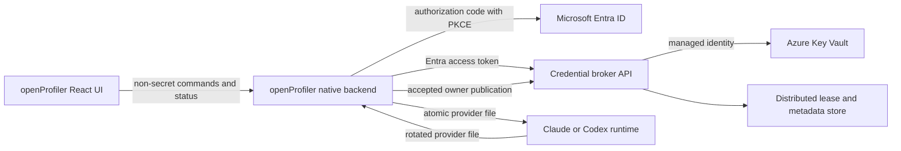

# Cloud Credential Vault and Broker

Status: proposed
Target: openProfiler after `0.1.4`
Scope: Claude and Codex credentials across Windows, WSL, containers, and
multiple workstations

## Summary

openProfiler should provide a remote credential authority for provider
profiles. Complete provider credential bundles are stored as versioned Azure
Key Vault secrets and checked out through an Entra-authenticated credential
broker.

The broker coordinates one refresh owner per provider account. This prevents
Windows, WSL, containers, or multiple workstations from independently rotating
copies of the same refresh token and invalidating each other.

Key Vault is the durable accepted-generation store. It is not a license to run
the same refresh credential concurrently in multiple runtimes.

## User Problem

Provider credentials currently live in workstation profile files:

```text
Claude: ~/.claude-profiles/profiles/<profile-path>/.credentials.json
Codex:  ~/.chatgpt-profiles/profiles/<profile-path>/auth.json
```

This creates four failure modes:

1. A provider logout or interrupted login can remove the only local
   credential.
2. A refreshed credential on Windows can leave WSL and containers with a
   revoked refresh-token generation.
3. Moving to a new workstation requires repeating provider authentication.
4. Copying credentials to avoid reauthentication creates multiple refresh
   writers and makes revocation races more likely.

openProfiler needs durable recovery without turning credential copies into
concurrent authorities.

## Goals

- Store each accepted complete credential bundle as a versioned Key Vault
  secret.
- Restore a still-valid credential on a new workstation after Entra
  authorization.
- Coordinate refresh ownership across Windows, WSL, containers, and
  workstations.
- Publish every accepted provider refresh as a new credential generation.
- Support company-owned and personal profile authorities without mixing their
  trust boundaries.
- Keep all credential contents out of the React webview, logs, analytics,
  crash reports, shell output, and source control.
- Preserve older Key Vault versions for bounded recovery and audit.
- Provide explicit deactivate, reauthenticate, and revoke operations.

## Non-Goals

- Key Vault cannot make a provider-revoked refresh token valid again.
- The feature does not permit simultaneous use of one rotating refresh token
  by multiple owners.
- openProfiler does not become the provider's OAuth authorization server.
- The browser UI does not receive or directly manage provider tokens.
- An email domain is not sufficient evidence of an Entra tenant or company
  authority.
- The feature does not silently upload existing credentials during profile
  discovery.

## Architecture



### React webview

The webview displays:

- profile and company names;
- declared provider identity;
- credential readiness;
- current refresh owner;
- checkout and synchronization status;
- recovery-required state;
- sanitized audit events.

The webview never receives a credential bundle, token, token fingerprint, raw
JWT claim set, Key Vault secret value, or Entra token.

### Native backend

The Tauri/Rust backend:

- authenticates the user with Entra using authorization code with PKCE;
- holds Entra tokens in an operating-system-protected token cache;
- calls the credential broker;
- validates provider credential shape and expected identity;
- atomically materializes credentials into approved provider profile paths;
- watches the owning runtime for atomic credential replacement;
- publishes accepted rotations;
- deletes or seals dormant checkouts according to local policy.

Credential bytes may exist only in native process memory, restricted temporary
files, the approved provider credential file, encrypted transport, and Key
Vault.

### Credential broker

The broker is the only service allowed to:

- authorize a user for a company and profile;
- issue and fence refresh-owner leases;
- read an exact Key Vault secret version;
- accept a new credential generation from the current lease owner;
- validate provider, profile, account, and generation metadata;
- advance the accepted-generation pointer;
- mark a profile conflicted, revoked, or recovery-required;
- emit sanitized audit events.

Clients do not receive direct Key Vault data-plane permissions.

### Azure Key Vault

Use a dedicated vault boundary per company, application, and environment. A
company deployment owns its vault, broker identity, authorization groups, and
retention policy.

Recommended controls:

- Azure RBAC data-plane authorization;
- broker managed identity with narrowly scoped secret read and write
  permissions;
- no standing secret-read role for workstation users;
- Privileged Identity Management for administrative access;
- soft delete and purge protection;
- private broker-to-vault network access where practical;
- Key Vault diagnostics sent to the company's security workspace;
- no emails or other personal data in secret names.

Personal profiles use a separately configured personal authority. Company
credentials must not be stored in another company's vault merely because the
same user operates both profiles.

## Company Connection

openProfiler records non-secret connection metadata:

```text
company_connection_id
display_name
entra_tenant_id
broker_url
broker_audience
authority_id
profile_registry_version
status
```

The initial company enrollment flow asks the user to select or enter the
company and then authenticates against its configured Entra tenant. It does
not discover an identity provider by searching the user's email address.

The broker maps the Entra tenant, subject, groups, and application roles to
authorized profile IDs.

## Credential Storage Model

### Secret naming

Use opaque immutable profile IDs:

```text
provider-credential--claude--<profile-id>
provider-credential--codex--<profile-id>
```

Profile aliases and emails remain in the authorized profile registry, not in
secret names.

### Secret value

Each Key Vault secret version contains one complete credential envelope:

```text
schema_version
provider
profile_id
credential_format
credential_bundle
published_at
source_lease_id
source_lease_epoch
generation_id
```

`credential_bundle` contains the complete native provider file. openProfiler
must never combine token fields from different generations.

### Authority metadata

Non-secret authority metadata is stored separately from Key Vault:

```text
profile_id
provider
expected_email
expected_account_id
accepted_generation_id
accepted_secret_version_uri
accepted_at
state
lease_owner
lease_epoch
lease_expires_at
```

The accepted secret is always addressed by exact version URI. A client must
not interpret the unnamed latest Key Vault version as authoritative.

Credential hashes may be used internally for equality checks, but are treated
as private operational metadata and are not displayed or logged.

## Distributed Refresh Lease

Each provider account has at most one active refresh owner:

```text
none
windows:<device-id>
wsl:<device-id>:<runtime-id>
container:<device-id>:<runtime-id>
```

A lease contains:

```text
lease_id
profile_id
account_id
owner
epoch
issued_at
heartbeat_at
expires_at
state
```

The monotonically increasing epoch is a fencing token. The broker rejects a
publication from an expired owner even if that owner still possesses an old
lease ID.

Key Vault stores credential generations but is not the lock service. The
broker uses a distributed metadata store with conditional writes or leases to
coordinate ownership and the accepted-version pointer.

## Broker API

The initial API surface is narrow:

```text
GET  /v1/profiles
GET  /v1/profiles/{profile-id}/status
POST /v1/profiles/{profile-id}/leases
POST /v1/profiles/{profile-id}/leases/{lease-id}/heartbeat
POST /v1/profiles/{profile-id}/checkout
POST /v1/profiles/{profile-id}/publish
POST /v1/profiles/{profile-id}/leases/{lease-id}/release
POST /v1/profiles/{profile-id}/reauthentication
POST /v1/profiles/{profile-id}/revoke
```

All mutating requests use request IDs and idempotency keys. Checkout and
publication require the current lease ID and epoch. Credential payloads travel
only between the native backend and broker over authenticated TLS and are
excluded from request logging and telemetry.

## Core Workflows

### Enroll an existing profile

1. Discover the local profile without reading credential contents into the
   webview.
2. Ask the user to select the owning personal or company authority.
3. Authenticate the user to that authority through Entra.
4. Acquire an enrollment transaction.
5. Validate the local provider file and expected account identity.
6. Upload it as the first Key Vault secret version.
7. Record the exact accepted version and non-secret profile metadata.
8. Verify a broker checkout and byte-for-byte native round trip.
9. Mark the profile `vault_backed`.

Enrollment is explicit and never part of passive profile discovery.

### Start a provider runtime

1. Resolve the identity profile and company connection.
2. Authenticate the user and authorize the profile.
3. Acquire the distributed refresh lease.
4. Checkout the exact accepted Key Vault generation.
5. Validate provider type, account identity, lease, and generation.
6. Atomically install the complete native credential file with restricted
   permissions.
7. Launch the provider runtime.
8. Heartbeat the lease and watch the parent credential directory.
9. Publish accepted rotations from the owning runtime.
10. Check in the final stable generation and release the lease on exit.

If another device owns the lease, openProfiler blocks startup and identifies
the owner and last heartbeat without exposing credential details.

### Publish a refresh

1. Detect that the owning runtime replaced its credential file.
2. Wait for two stable reads with the same hash.
3. Validate the native structure and expected account identity.
4. Send the complete bundle with the lease ID, epoch, and previous generation.
5. Have the broker verify current ownership.
6. Write a new Key Vault secret version.
7. Conditionally advance the accepted-version pointer.
8. Mark non-owning checkouts stale.

A Key Vault version written before a failed pointer update is an unaccepted
orphan and must never be restored automatically.

### Transfer ownership

1. Ask the current owner to publish its final stable generation.
2. Stop or otherwise prove the current runtime cannot refresh.
3. Release its lease.
4. Acquire a new lease with a higher epoch.
5. Checkout the exact accepted generation into the new owner.
6. Start and verify the new runtime.

The broker must not overwrite a credential file belonging to a running
non-owner.

### Reauthenticate safely

Reauthentication uses an isolated staging home instead of the canonical
profile directory:

1. Preserve the accepted Key Vault generation.
2. Create a restricted temporary Claude or Codex configuration home.
3. Start the provider's supported login flow in that staging home.
4. Wait for provider completion.
5. Validate the resulting complete credential and expected account identity.
6. Publish it as a new accepted Key Vault generation.
7. Atomically install the accepted generation into the canonical local profile.
8. Destroy the staging home.

An interrupted login therefore cannot erase the last accepted local or remote
credential. If the provider explicitly revoked the previous refresh token,
that older version remains retained for audit but is not considered usable.

### Deactivate, reauthenticate, and revoke

These are separate user operations:

- **Deactivate this device:** publish the final owner generation, release the
  lease, and remove or seal the local checkout. Preserve Key Vault.
- **Sign in again:** use the staged reauthentication workflow and publish a new
  accepted generation.
- **Revoke everywhere:** invoke the provider's supported logout or revocation
  flow, release all ownership, and mark the authority record revoked. Retain or
  disable historical Key Vault versions according to company policy.

Deletion of a local credential by an unmanaged provider process is not a
request to delete Key Vault data. openProfiler marks the checkout
`recovery_required` and requires an explicit restore or reauthentication
decision.

### Restore on a new workstation

1. Install openProfiler without provider credentials.
2. Add the company connection using its known tenant and broker information.
3. Authenticate with Entra.
4. Discover the user's authorized profiles from the broker.
5. Acquire a lease for the selected profile.
6. Checkout and validate the accepted generation.
7. Materialize the provider profile structure and credential atomically.
8. Verify provider account status.

Restore can avoid provider authentication only while the accepted refresh
credential remains valid.

## Conflict and Failure Handling

The broker enters `conflict` or `recovery_required` when:

- two runtimes changed credentials without a valid owner;
- an expired lease owner attempts publication;
- the credential account does not match the profile;
- the provider file changes during snapshot;
- the accepted-version pointer and Key Vault generation disagree;
- a restored refresh token is rejected;
- a broker restart cannot establish one current owner.

Resolution stops all writers and prefers the final generation from the
recorded lease owner. The broker never repeatedly tests competing refresh
tokens because one refresh attempt may invalidate another candidate.

If ownership or identity cannot be proven, the required recovery is a fresh
staged provider login.

## Local Storage

Provider runtimes still require native credential files. openProfiler writes
those files atomically and restricts access:

- Unix files use mode `0600`;
- Windows files preserve a user-only ACL;
- source and target paths must be regular files beneath approved roots;
- symlinks and path traversal are rejected;
- temporary files are created beside the destination, flushed, renamed
  atomically, and removed on failure.

An optional operating-system-sealed cache may support read-only diagnostics
while offline. It never grants refresh ownership without a broker lease.

## SOPS Relationship

The existing SOPS registry becomes optional cold disaster-recovery escrow. It
is not the active synchronization channel, accepted-generation pointer, or
lease authority.

SOPS restoration must not overwrite a newer accepted Key Vault generation.
Because old refresh tokens may have been rotated or revoked, restored SOPS
material always enters `recovery_required` until validated by a controlled
owner.

## Security Requirements

- Use Entra authorization code with PKCE for the native application.
- Authorize company and profile access in the broker, not only in the client.
- Give workstations no direct Key Vault data-plane role.
- Use managed identity between the broker and Key Vault.
- Apply least-privilege Azure RBAC and just-in-time administrator access.
- Enable Key Vault soft delete, purge protection, diagnostics, and alerts.
- Never put provider credentials, Entra tokens, raw JWT claims, or credential
  hashes in normal logs or audit events.
- Redact HTTP bodies before broker telemetry is initialized.
- Keep secrets out of React state, Tauri events, clipboard operations, crash
  reports, and support bundles.
- Require account-ID equality; an email match alone is insufficient once an
  account ID has been enrolled.
- Preserve a bounded sanitized audit trail of lease, checkout, publish,
  transfer, reauthentication, and revocation events.

## Product States

Each profile displays one of:

```text
local_only
enrollment_available
vault_backed
checked_out_here
active_here
active_elsewhere
stale_checkout
reauthentication_required
conflict
revoked
unavailable
```

The UI displays the current owner device, last successful synchronization, and
required action. It never claims that a token is valid based only on Key Vault
presence.

## Acceptance Criteria

1. A user can enroll a Claude or Codex profile without credential material
   entering the webview or logs.
2. A fresh workstation can restore a valid enrolled profile after Entra
   authorization.
3. Windows and WSL cannot simultaneously own refresh rights for the same
   account.
4. A stale or expired owner cannot publish after a lease transfer.
5. A provider refresh creates a new Key Vault version and atomically advances
   the accepted-version pointer.
6. A failed or cancelled reauthentication leaves the prior accepted
   generation intact.
7. Local credential deletion does not delete or replace the Key Vault
   authority.
8. Account mismatches fail closed before local activation or remote
   publication.
9. Provider logout is distinct from local deactivation and cannot be triggered
   accidentally by removing a checkout.
10. Automated tests verify that credentials are absent from frontend payloads,
    logs, audit records, errors, and crash diagnostics.
11. Company profiles cannot be restored through another company's authority.
12. SOPS or an older Key Vault version cannot silently overwrite a newer
    accepted generation.

## Delivery Plan

### Phase 1: Authority inventory

- Add company connections and non-secret remote profile metadata.
- Display local-only and vault-backed state.
- Detect duplicate accounts and unmanaged concurrent writers.
- Make no remote credential changes.

### Phase 2: Broker and vault enrollment

- Deploy one company broker, managed identity, metadata store, and dedicated
  Key Vault.
- Implement explicit enrollment, exact-version checkout, and audit.
- Support manual restore with no automatic runtime launch.

### Phase 3: Distributed leases

- Implement lease acquisition, heartbeat, epoch fencing, release, and crash
  recovery.
- Integrate Windows and WSL ownership transfer.
- Block unmanaged concurrent activation where detectable.

### Phase 4: Provider adapters

- Add complete-bundle validation for Claude and Codex.
- Add stable file watchers and accepted rotation publication.
- Integrate `pclaude` and `pcodex` with broker leases.

### Phase 5: Staged reauthentication

- Add isolated provider login homes.
- Add explicit deactivate, sign-in-again, and revoke workflows.
- Add rollback and recovery-required handling.

### Phase 6: Multi-company and migration

- Add company-specific Entra authorities and broker discovery.
- Migrate explicitly selected SOPS and local profiles.
- Retain SOPS only under documented cold-escrow policy.

## Dependencies

- Microsoft Entra application registration for the native openProfiler client;
- company credential broker application and API scope;
- broker managed identity;
- dedicated Azure Key Vault with Azure RBAC;
- distributed metadata and lease store;
- provider-specific credential validators;
- native OS token-cache integration;
- `pclaude` and `pcodex` broker-aware launchers.

## Related Documents

- [Claude OAuth enrollment and automated reauthentication](claude-oauth-enrollment-automation.md)
- [Codex credential rotation and synchronization architecture](codex-token-management-architecture.md)
- [Codex identity and history profile architecture](codex-history-profile-architecture.md)
- [Azure Key Vault security guidance](https://learn.microsoft.com/azure/key-vault/general/secure-key-vault)
- [Azure Key Vault authentication](https://learn.microsoft.com/azure/key-vault/general/authentication)
- [OAuth 2.0 Security Best Current Practice](https://www.rfc-editor.org/rfc/rfc9700.html)
